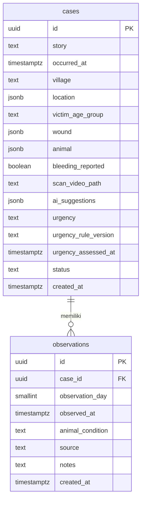

# Database MVP RAKSA

Status per 7 November 2026: **rancangan siap ditinjau, belum diterapkan**. SQL di bawah ditujukan untuk SQL Editor pada proyek Supabase RAKSA yang baru. Wireframe pen.dev adalah acuan sementara, bukan kontrak final. Tidak ada tabel individu hewan. Tabel utama tetap `cases` dan `observations`.

## Tambahan yang saya usulkan

Wireframe menunjukkan detail luka, kelompok usia korban, desa, scan video, hasil AI, antrean, dan laporan kondisi hewan selama 14 hari. Saya menambahkan tempat untuk data tersebut tanpa menambah tabel utama. `wound` dan `animal` memakai JSONB agar bentuk isian bisa berubah. `ai_suggestions` terpisah dari jawaban terkonfirmasi. Nilai urgensi dibiarkan kosong sampai aturan Python dan tenaga kesehatan memvalidasinya. Identitas pasien, tautan akses pemilik, dan fasilitas rujukan belum dimodelkan karena alur akses serta kebutuhan datanya belum diputuskan.

## ERD



`cases.id` → `observations.case_id` adalah relasi satu ke banyak. Satu kasus dapat memiliki observasi hari 1–14. Untuk laporan harian pemilik, kombinasi kasus dan hari hanya boleh muncul sekali. Observasi petugas di luar jadwal boleh tidak mempunyai `observation_day`.

## Properti `cases`

| Kolom | Tipe | Arti |
| --- | --- | --- |
| `id` | UUID, PK | Identitas kasus. |
| `story` | TEXT, wajib | Cerita yang dikonfirmasi pengguna. |
| `occurred_at` | TIMESTAMPTZ, opsional | Waktu kejadian. |
| `village` | TEXT, opsional | Nama desa/area yang ditampilkan dalam antrean. |
| `location` | JSONB, opsional | Koordinat `latitude` dan `longitude` bila pengguna memberi izin. |
| `victim_age_group` | TEXT, opsional | Kelompok umur, tanpa identitas korban. |
| `wound` | JSONB | Detail luka yang dikonfirmasi, misalnya `event_type`, `body_part`, `wound_count`, `skin_broken`. |
| `animal` | JSONB | `species`, `ownership`, `vaccination_status`, perilaku/kondisi hewan, dan path foto/kartu vaksin opsional. |
| `bleeding_reported` | BOOLEAN, opsional | `NULL` berarti belum diketahui. Video yang tidak memperlihatkan darah tidak mengubahnya ke `FALSE`. |
| `scan_video_path` | TEXT, opsional | Path video pada bucket privat. Bucket belum dibuat. |
| `ai_suggestions` | JSONB, opsional | Usulan ekstraksi cerita/vision sebelum dikonfirmasi. Bukan fakta klinis. |
| `urgency` | TEXT, opsional | Hasil aturan terverifikasi untuk antrean/rujukan. |
| `urgency_rule_version` | TEXT, opsional | Versi aturan Python yang menghasilkan urgensi. |
| `urgency_assessed_at` | TIMESTAMPTZ, opsional | Waktu perhitungan urgensi. |
| `status` | TEXT | `reported`, `in_review`, `observing`, atau `closed`. |
| `created_at` | TIMESTAMPTZ | Waktu pembuatan. |

## Properti `observations`

| Kolom | Tipe | Arti |
| --- | --- | --- |
| `id` | UUID, PK | Identitas observasi. |
| `case_id` | UUID, FK | Kasus yang diamati. |
| `observation_day` | SMALLINT, opsional | Hari 1–14 untuk laporan pemilik. |
| `observed_at` | TIMESTAMPTZ | Waktu pengamatan. |
| `animal_condition` | TEXT, opsional | `healthy`, `sick`, `dead`, atau `missing`. |
| `source` | TEXT | `owner` atau `officer`. Nilai ini nanti ditetapkan backend dari identitas yang diverifikasi. |
| `notes` | TEXT, opsional | Catatan tambahan. Pemilik dapat memilih kondisi tanpa mengetik catatan. |
| `created_at` | TIMESTAMPTZ | Waktu penyimpanan. |

## SQL untuk proyek Supabase baru

Jalankan blok ini **sekali** di SQL Editor proyek RAKSA yang baru. SQL menyalakan RLS dan mencabut akses `anon`/`authenticated`. Backend belum memiliki autentikasi/otorisasi untuk data sensitif. Jika kelak memakai `service_role`, kuncinya hanya boleh di server dan setiap operasi perlu pemeriksaan akses sendiri. SQL ini tidak membuat bucket media atau kebijakan unggah.

```sql
begin;

create table public.cases (
    id uuid primary key default gen_random_uuid(),
    story text not null check (char_length(btrim(story)) between 1 and 10000),
    occurred_at timestamptz,
    village text,
    location jsonb check (location is null or jsonb_typeof(location) = 'object'),
    victim_age_group text,
    wound jsonb not null default '{}'::jsonb check (jsonb_typeof(wound) = 'object'),
    animal jsonb not null default '{}'::jsonb check (jsonb_typeof(animal) = 'object'),
    bleeding_reported boolean,
    scan_video_path text,
    ai_suggestions jsonb check (ai_suggestions is null or jsonb_typeof(ai_suggestions) = 'object'),
    urgency text,
    urgency_rule_version text,
    urgency_assessed_at timestamptz,
    status text not null default 'reported'
        check (status in ('reported', 'in_review', 'observing', 'closed')),
    created_at timestamptz not null default now()
);

create table public.observations (
    id uuid primary key default gen_random_uuid(),
    case_id uuid not null references public.cases(id) on delete restrict,
    observation_day smallint check (observation_day between 1 and 14),
    observed_at timestamptz not null,
    animal_condition text
        check (animal_condition in ('healthy', 'sick', 'dead', 'missing')),
    source text not null check (source in ('owner', 'officer')),
    notes text check (notes is null or char_length(btrim(notes)) between 1 and 10000),
    created_at timestamptz not null default now()
);

create unique index observations_case_day_unique
    on public.observations(case_id, observation_day)
    where observation_day is not null;
create index observations_case_time_idx
    on public.observations(case_id, observed_at desc);
create index cases_queue_idx
    on public.cases(status, created_at desc);

alter table public.cases enable row level security;
alter table public.observations enable row level security;
revoke all on table public.cases, public.observations from anon, authenticated;
grant select, insert, update, delete on table public.cases, public.observations to service_role;

commit;
```

## Seed dari terminal VS Code

Setelah tabel berhasil dibuat, buka terminal VS Code di folder repo **Desktop**. Jalankan pemeriksaan lokal berikut tanpa koneksi database.

```powershell
python scripts/seed.py --check
```

Di Supabase Dashboard proyek RAKSA, salin **Project URL** dan **secret key** (`sb_secret_...`). Pada terminal PowerShell yang sama, set sebagai environment variable untuk sesi terminal itu lalu jalankan seed.

```powershell
$env:SUPABASE_URL = "https://PROJECT_REF.supabase.co"
$env:SUPABASE_SECRET_KEY = "sb_secret_ISI_DARI_DASHBOARD"
python scripts/seed.py --apply
```

Ganti contoh URL dan key dengan nilai dari proyek RAKSA. Jangan tempel nilai key asli ke file repo atau chat. Skrip mengirim data sintetis dari [`seed.json`](seed.json) ke `cases`, lalu `observations`, dan mengabaikan ID yang sudah ada jika dijalankan lagi. Jika langkah kedua gagal, kasus yang sudah masuk tetap ada dan perintah dapat diulang. JSON tidak otomatis terimpor saat SQL pembuatan tabel dijalankan.

Skema ini masih perlu diselaraskan dengan `app/schemas.py`, karena API saat ini hanya memvalidasi kontrak dasar dan endpoint penulisan masih mengembalikan 503. Sebelum data nyata masuk, tentukan akses pelapor, petugas, dan pemilik hewan. Aturan urgensi dan informasi klinis wajib divalidasi tenaga kesehatan.

Rujukan Supabase: [RLS](https://supabase.com/docs/guides/database/postgres/row-level-security), [pengamanan Data API](https://supabase.com/docs/guides/api/securing-your-api), dan [API keys](https://supabase.com/docs/guides/getting-started/api-keys).

## Tambahan rancangan: profil petugas

`auth.users` 1 → 0..1 `public.officers` melalui `officers.id`; data profil terdiri dari `id` (UUID PK/FK), `full_name` (text wajib), `organization` dan `phone` (text opsional), serta `created_at` (timestamptz). Password dikelola Supabase Auth. SQL terpisah: [officers.sql](officers.sql). Tabel ini belum diverifikasi atau diterapkan pada database live, dan endpoint login saat ini belum membaca profilnya. Rancangan dua tabel di atas tetap dipakai untuk data kasus dan observasi.
